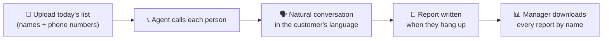
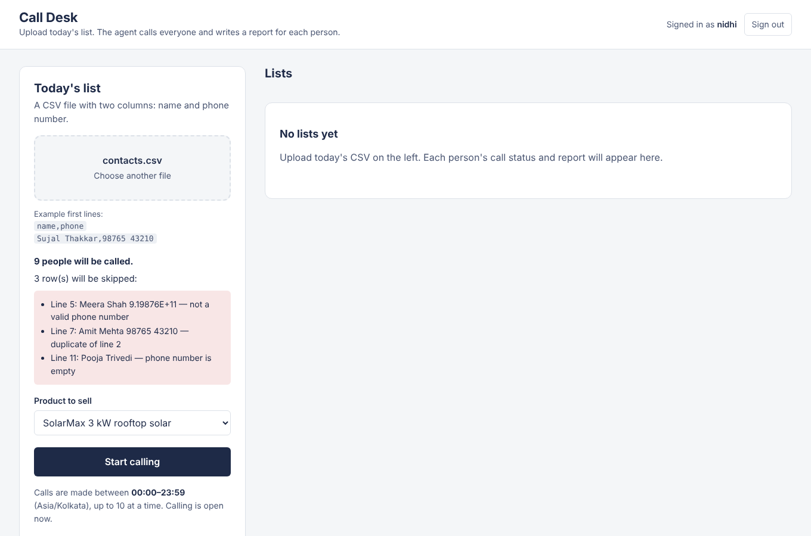
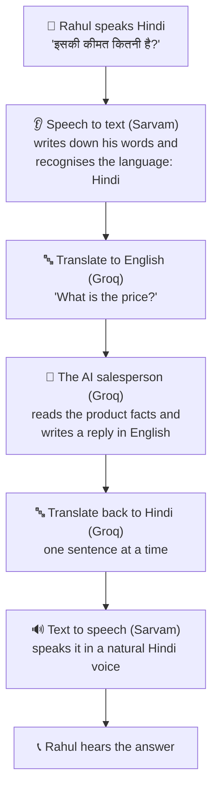
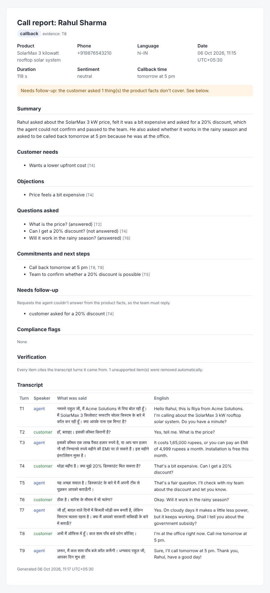
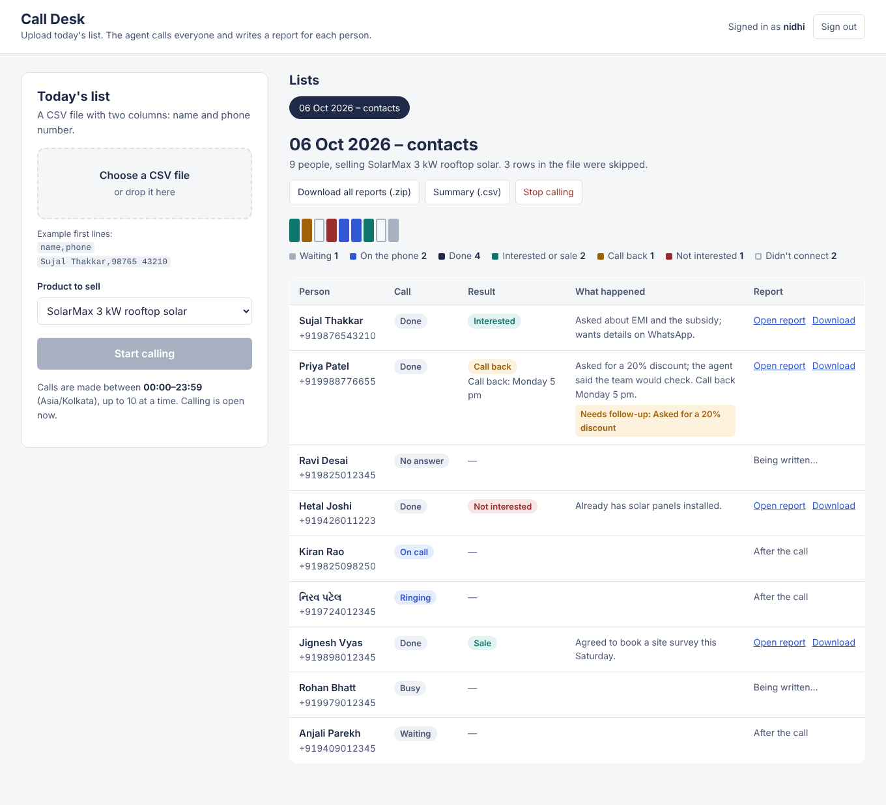
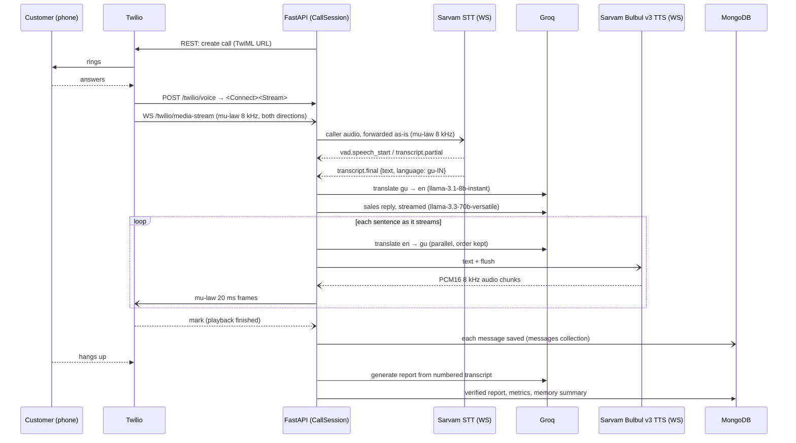
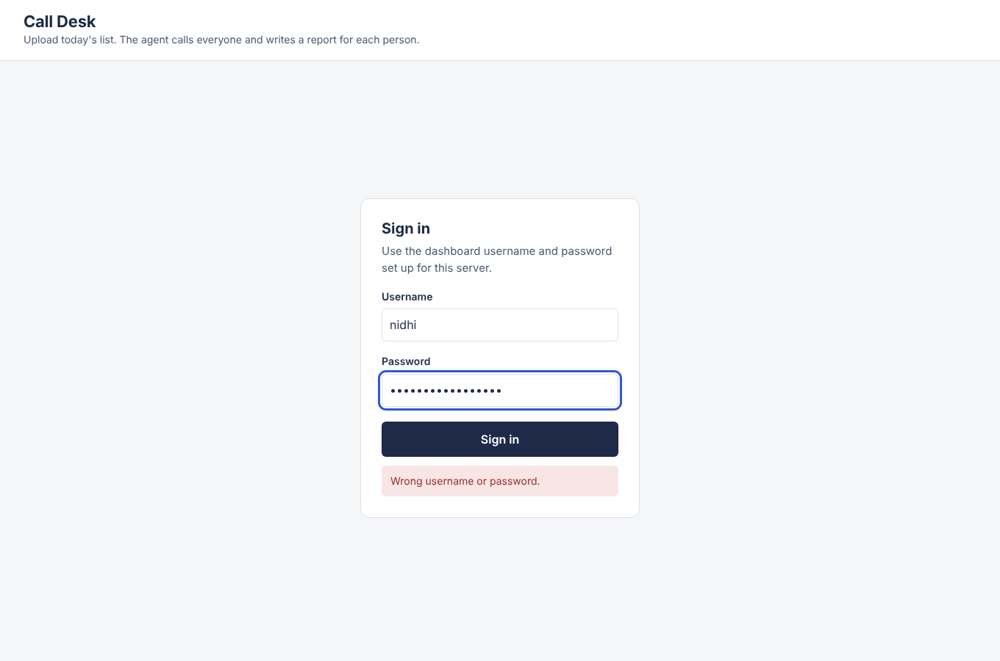

# Multilingual AI Voice Sales Agent

An outbound AI calling agent that phones customers and sells a product **in the customer's own language**. The caller can speak Gujarati, Hindi, Marathi, Tamil, English or other Indian languages, and the agent replies in that same language with a natural voice, in real time.

Built with **FastAPI**, **Twilio Media Streams**, **Sarvam AI** (Saaras v4 streaming STT and Bulbul v3 streaming TTS), **Groq** (LLM reasoning and translation) and **MongoDB**.

> **New here or not technical?** Read [The whole flow, in plain words](#the-whole-flow-in-plain-words) first. It follows one real-looking day from start to finish. Developers can skip to [Features](#features) and [Architecture](#architecture).

---

## The whole flow, in plain words

### What problem does this solve?

A company has a list of people to call about a product, for example a rooftop solar system. Calling hundreds of people every day takes a whole team, and many customers are more comfortable speaking Hindi, Gujarati or another Indian language than English.

This project is an **AI phone agent** that does those calls. Someone uploads the day's list, the agent phones each person, talks to them **in whatever language they speak**, answers their questions using only the real product details, and writes a short report on every call.

### The big picture



### One day, step by step

Let's follow **Nidhi**, a sales manager at a (made-up) solar company called *Acme Solutions*.

#### 1. Morning: Nidhi uploads the list

Nidhi has a spreadsheet of people who showed interest on the website. She saves it as a CSV file:

```
name,phone
Rahul Sharma,98765 43210
Priya Patel,+91 99887 76655
Amit Verma,98250-11122
```

She opens the **Call Desk** page in her browser and signs in with her username and password. There's no secret key to paste anywhere on the page. Then she drops the file in, picks the product *"SolarMax 3 kW rooftop solar"* and presses **Start calling**.

The page checks the file first. If a number were wrong (too short, or mangled by Excel) or listed twice, it would show exactly which line and why, and skip it.



#### 2. The agent starts calling

The agent calls a few people at a time, and only between 9 am and 9 pm. Nidhi can watch each name change from *Waiting* to *Ringing* to *On call* to *Done*.

#### 3. A real conversation, in Hindi

Rahul picks up. Nidhi's company has set Hindi as the greeting language for new customers (one setting, `DEFAULT_LANGUAGE=hi-IN`), so the agent greets him in Hindi. Here is the call. The right-hand column is the English meaning, shown only for this README; Rahul hears only Hindi.

| | Who | What Rahul hears / says | English meaning |
|---|---|---|---|
| T1 | Agent | नमस्ते राहुल जी, मैं Acme Solutions से रिया बोल रही हूँ। मैं SolarMax 3 किलोवाट रूफटॉप सोलर सिस्टम के बारे में कॉल कर रही हूँ। क्या आपके पास एक मिनट है? | Hello Rahul, this is Riya from Acme Solutions. I'm calling about the SolarMax 3 kW rooftop solar system. Do you have a minute? |
| T2 | Rahul | हाँ, बताइए। इसकी कीमत कितनी है? | Yes, tell me. What is the price? |
| T3 | Agent | इसकी कीमत एक लाख पैंसठ हज़ार रुपये है, या आप चार हज़ार नौ सौ निन्यानवे रुपये महीने की EMI पर ले सकते हैं। इस महीने इंस्टॉलेशन मुफ़्त है। | It costs 1,65,000 rupees, or you can pay an EMI of 4,999 rupees a month. Installation is free this month. |
| T4 | Rahul | थोड़ा महँगा है। क्या मुझे 20% डिस्काउंट मिल सकता है? | That's a bit expensive. Can I get a 20% discount? |
| T5 | Agent | यह अच्छा सवाल है। डिस्काउंट के बारे में मैं अपनी टीम से पूछकर आपको बताऊँगी। | That's a fair question. I'll check with my team about the discount and let you know. |
| T6 | Rahul | ठीक है। बारिश के मौसम में भी चलेगा? | Okay. Will it work in the rainy season? |
| T7 | Agent | जी हाँ, बादल वाले दिनों में बिजली थोड़ी कम बनती है, लेकिन सिस्टम चलता रहता है। क्या मैं आपको सरकारी सब्सिडी के बारे में बताऊँ? | Yes. On cloudy days it makes a little less power, but it keeps working. Shall I tell you about the government subsidy? |
| T8 | Rahul | अभी मैं ऑफिस में हूँ। कल शाम पाँच बजे फ़ोन कीजिए। | I'm at the office right now. Call me tomorrow at 5 pm. |
| T9 | Agent | ज़रूर, मैं कल शाम पाँच बजे कॉल करूँगी। धन्यवाद राहुल जी, आपका दिन शुभ हो! | Sure, I'll call tomorrow at 5 pm. Thank you, Rahul, have a good day! |

Then the agent hangs up politely. If Rahul had answered in English or Gujarati instead, the agent would have switched to that language from the next reply.

#### 4. What happens behind one sentence

When Rahul asks *"इसकी कीमत कितनी है?"* (What is the price?), five things happen, aiming for a reply within a second or two:



Why think in English and translate both ways? The AI's instructions and safety rules are written once, in English, and work the same for every language. Adding a new language needs no new instructions.

Why does it sound quick? The agent starts speaking the **first sentence** while the next ones are still being written and translated, the same way a person starts answering before they've planned every word. If Rahul interrupts, the agent stops talking immediately and listens.

#### 5. The agent can't make things up

The price, offer and features the agent mentions come **only** from the product details stored in the system. There is no discount in those details, so when Rahul asks for 20% off (T4), the agent neither agrees nor refuses. It says it will check with the team (T5).

At the same moment, the agent quietly flags the request for the sales team. Rahul never hears this flag. It's saved with the conversation and shows up in the report under **Needs follow-up**, so nobody forgets to give Rahul an answer about the discount. The same happens for any question the product details don't cover, such as a delivery date, a feature or a policy.

#### 6. Rahul hangs up, and a report is written

As soon as the call ends, the AI writes a report. Every point in it has to say which line of the conversation it came from (T2, T4, T6…), and the system **checks those references automatically**. A point that doesn't match what was actually said is removed, so the report can't claim something that never happened.

The report also stores **the entire conversation**, every line in Hindi with the English beside it, so it's complete on its own even years later.

Here is Rahul's report, made by the project's own report code ([Markdown version](docs/sample-report.md)):



Notice three things:

- **Needs follow-up** lists the 20% discount request [T4]. The amber banner at the top makes sure the team sees it.
- **Questions asked** marks the discount question as *not answered*, while the price and rainy-season questions were answered.
- **"1 unsupported item removed"**: in this example the AI also wrote *"Customer wants to buy two systems"*. Rahul never said that, so it had no line to point to, and the check removed it automatically.

#### 7. The other two people on the list

- **Priya Patel** didn't pick up. Her row says *No answer*, and she still gets a short report saying no conversation took place.
- **Amit Verma** was greeted in Hindi but answered in English, so the agent switched to English. He said he already has solar panels, and the agent thanked him and ended the call. His report says *Not interested*.

#### 8. End of day: Nidhi downloads everything

On the Call Desk page, the coloured board and table show every person's result at a glance:



Nidhi clicks **Download all reports (.zip)** and gets one file per person, named after them:

```
001-Rahul-Sharma-3210.md
002-Priya-Patel-6655.md
003-Amit-Verma-1122.md
summary.csv
```

`summary.csv` opens in Excel with one row per person (some columns, like status and report link, left out here):

| name | phone | outcome | callback_time | needs_follow_up | summary |
|---|---|---|---|---|---|
| Rahul Sharma | +919876543210 | callback | tomorrow at 5 pm | customer asked for a 20% discount | Asked about price, a 20% discount and the rainy season; call back tomorrow 5 pm. |
| Priya Patel | +919988776655 | no_conversation | | | No conversation took place. |
| Amit Verma | +919825011122 | not_interested | | | Already has solar panels installed. |

#### 9. Tomorrow

Nidhi uploads tomorrow's list the same way. If Rahul is on it again, the agent already knows he speaks Hindi and remembers notes from today's call (treating them as "please confirm"), so it doesn't start from zero. Anyone who asked never to be called again is skipped automatically.

### Words used in this project

| Term | Plain meaning |
|---|---|
| **AI agent** | The computer program that holds the phone conversation |
| **Speech to text (STT)** | Turns spoken words into written text. Here: Sarvam AI, which understands 20+ Indian languages |
| **Text to speech (TTS)** | Turns written text into a natural voice. Here: Sarvam's *Bulbul* voices |
| **LLM** | The "brain" that understands the conversation and writes replies. Here: models running on Groq, which is very fast |
| **Twilio** | The phone service that actually places the calls |
| **MongoDB** | The database where customers, conversations and reports are saved |
| **CSV** | A simple spreadsheet file; Excel can save any sheet as CSV |
| **Batch** | One uploaded list (for example, "Monday's list") |
| **Report** | The written summary of one call, with the full conversation attached |

### For developers: the same flow in technical terms

```
Customer speaks Hindi  ->  Sarvam STT (saaras:v4) detects hi-IN  ->  Groq (8B) translates to English
  ->  Groq (70B) sales agent replies in English, streamed  ->  Groq translates each sentence to Hindi
  ->  Sarvam Bulbul v3 streams Hindi audio  ->  Twilio plays it to the customer
```

---

## Features

- **Daily CSV upload page**: upload a `name,phone` list each day, watch every call live, and download each person's report (see [Daily call lists](#daily-call-lists-csv-upload))
- **Outbound calling** via Twilio, with a background dialer that respects concurrency limits and calling hours (09:00–21:00 IST by default)
- **Automatic language detection** for every utterance (`language_code=auto`) across 20+ Indian languages
- **English reasoning core**: the LLM always works in English, and translation happens on both sides. Prompts, guardrails and evaluation stay in one language.
- **Replies in the caller's language** with Bulbul v3 voices, streamed sentence by sentence
- **Low latency** from end-to-end streaming, pre-warmed TTS sockets, and no audio transcoding on input (see [Latency design](#latency-design))
- **Barge-in**: if the customer interrupts, the agent stops talking immediately
- **Voicemail detection**: answering machines are hung up automatically
- **Silence handling**: nudges a silent caller twice, then ends politely
- **Agent-initiated hang-up**: the LLM can end the call, and the hang-up waits until the goodbye has actually been heard
- **Smart conversation memory**, modelled on LangChain: one MongoDB document per message, recent turns kept word for word, older turns folded into a fact-only summary, plus notes from previous calls (see [Conversation memory](#conversation-memory))
- **Secure sign-in for the Call Desk page**: hashed password and an HttpOnly session cookie; the API key never appears in the browser
- **Follow-up tracking**: anything the customer asks that the product facts don't cover (like a 20% discount) is flagged during the call and listed in the report for the team
- **Downloadable post-call report**: generated by Groq when the customer hangs up, with every claim citing the transcript turn it came from, and download as Markdown, HTML or JSON (see [Post-call report](#post-call-report))
- **Hallucination safeguards** in the agent, the memory and the report (see [How hallucination is prevented](#how-hallucination-is-prevented))
- **Do-not-call list**: respected automatically, and updated when a customer asks
- **Per-turn latency metrics** stored with every call
- **Production basics**: API-key auth, Twilio signature validation, HMAC-signed media streams, JSON logs, health and readiness probes, Docker, CI, and 94 tests

---

## Architecture



### Project layout

```
app/
├── main.py                  # FastAPI app, lifespan (shared clients), health/ready probes
├── config.py                # All settings from env (.env)
├── auth.py                  # Dashboard login: scrypt password hash, signed session cookie, rate limit
├── security.py              # Session-or-API-key auth, CSRF guard, Twilio signature check, HMAC tokens
├── db.py                    # PyMongo native async client + indexes
├── repositories.py          # All MongoDB queries
├── models.py                # Pydantic request/response schemas
├── static/index.html        # Call Desk: the daily upload + progress page (no build step)
├── api/
│   ├── routes_admin.py      # Products, customers, calls, campaigns REST API
│   ├── routes_auth.py       # Sign-in / sign-out for the Call Desk page
│   ├── routes_batches.py    # Daily CSV uploads, batch progress, ZIP of reports, summary CSV
│   ├── routes_reports.py    # Report download (API key or signed link)
│   └── routes_twilio.py     # Twilio webhooks + media-stream WebSocket
├── pipeline/
│   ├── call_session.py      # Per-call orchestrator (the real-time brain)
│   ├── memory.py            # LangChain-style summary-buffer chat memory
│   ├── report.py            # Post-call report: generate, verify citations, render md/html/json
│   └── text.py              # Sentence chunker for streaming TTS, text cleanup
└── services/
    ├── stt.py               # Sarvam realtime STT (saaras:v4) wrapper
    ├── tts.py               # Sarvam Bulbul v3 WebSocket TTS + pre-warm pool
    ├── llm.py               # Groq: translation, sales agent, memory summaries, report
    ├── telephony.py         # Twilio REST (run in threads; SDK is blocking)
    ├── dialer.py            # Background queue: concurrency limit, calling hours, multi-replica safe
    ├── csv_import.py        # Robust name/phone CSV parsing + Indian number normalisation
    ├── audio.py             # mu-law codec (numpy), WAV header strip, 20 ms framing
    └── languages.py         # Language codes, TTS fallbacks
scripts/seed_db.py           # Sample product + customer
scripts/hash_password.py     # Creates DASHBOARD_PASSWORD_HASH + SESSION_SECRET for .env
tests/                       # 94 tests (pipeline, memory, reports, follow-ups, login, CSV, dialer, API)
```

---

## Daily call lists (CSV upload)

Open **http://localhost:8000/** for the Call Desk page. Each day:

1. Sign in with the dashboard username and password (see [Signing in](#signing-in-to-the-call-desk)).
2. Drop in a CSV with two columns, **name** and **phone number** ([example](docs/sample-contacts.csv)).
3. Check the preview. It shows how many people will be called and lists every skipped row with its line number and the reason.
4. Pick the product and press **Start calling**.
5. Watch the board fill in: one mark per person, coloured by status and result. Each row shows the person's name, the result, a one-line summary and their report.
6. Download **all reports (.zip)**, one file per person named after them, or the **summary (.csv)**, which has one row per person with outcome, callback time, summary and report link.


**What the importer accepts**

| In the file | Becomes |
|---|---|
| `98765 43210`, `098765-43210`, `919876543210`, `+91 98765 43210` | `+919876543210` |
| `+1 415 555 0100` (any number with a country code) | `+14155550100` |
| Header names like `Name`, `Customer Name`, `Phone`, `Mobile No.`, `Contact Number` | detected automatically |
| No header row, `;` or tab separators, Excel's UTF-8 BOM, Gujarati or Hindi names | handled |
| Invalid numbers, Excel's `9.19876E+11`, empty phone cells, duplicates | skipped and listed with the reason |

**How the calls are made**

- Uploading creates a **batch** and one queued call per valid row. The person's name and number from that day's file are stored on the call, so the report always carries the right name.
- A **background dialer** works through the queue. It keeps at most `MAX_CONCURRENT_OUTBOUND_CALLS` calls live at once (counted in MongoDB, so the limit holds across several servers) and calls only inside `CALLING_HOURS_START`–`CALLING_HOURS_END` in `CALLING_TIMEZONE`. Lists uploaded outside those hours simply wait.
- Each call is claimed with an atomic MongoDB `find_one_and_update`, so two servers can never dial the same person. Calls stuck mid-dial after a restart are put back in the queue.
- People who come up again on another day reuse the same customer record. Their learned language and do-not-call flag are kept, and do-not-call numbers are skipped.
- **Stop calling** cancels everyone in the list who hasn't been dialled yet.
- **Every** person gets a saved report: answered calls when they hang up, and unanswered, busy or failed calls get a "no conversation" report shortly after Twilio reports the final status.

The same features are available over the API:

```bash
# check a file without saving anything
curl -X POST http://localhost:8000/api/v1/batches/preview -H "X-API-Key: $API_KEY" -F file=@today.csv
# upload and start calling
curl -X POST http://localhost:8000/api/v1/batches -H "X-API-Key: $API_KEY" -F file=@today.csv -F product_sku=SOLARMAX-3KW
# progress, per-person results and report links
curl http://localhost:8000/api/v1/batches/<batch-id> -H "X-API-Key: $API_KEY"
# everyone's reports, named by person
curl -OJ http://localhost:8000/api/v1/batches/<batch-id>/reports.zip -H "X-API-Key: $API_KEY"
```

---

## Signing in to the Call Desk

The page never asks for, shows or stores the API key. People sign in with a username and password instead:



**Set it up once:**

```bash
python -m scripts.hash_password
```

It asks for a password (at least 10 characters) and prints two lines for your `.env`:

```
DASHBOARD_PASSWORD_HASH=scrypt:16384:8:1:...   # only a salted hash, never the password itself
SESSION_SECRET=...                              # signs the session cookies
```

Also set `DASHBOARD_USERNAME` (default `admin`).

**How it's protected:**

| Risk | Protection |
|---|---|
| Password stolen from the server | Only a salted **scrypt** hash is stored; the password itself is never saved |
| Key or token stolen from the page | After sign-in the server sets an **HttpOnly** cookie, which JavaScript (and so any injected script or extension) cannot read. Nothing secret is kept in the page or `localStorage` |
| Cookie forged or edited | The cookie is **HMAC-signed** with `SESSION_SECRET` and expires after `SESSION_HOURS` (12 by default) |
| Cookie sent over plain HTTP | **Secure** flag (HTTPS only; browsers still allow it on `http://localhost` for development) |
| Another website triggering actions | Cookie is **SameSite=Strict**, and every change also needs an `X-Requested-With: CallDesk` header that other sites can't send |
| Password guessing | Five failed attempts from one address block sign-in for 5 minutes |

Scripts and `curl` keep using the `X-API-Key` header. Signed `report_url` links still open single reports without signing in, which is useful for sharing one report with a manager.

---

## Conversation memory

Memory follows the same design as LangChain, implemented directly (about 150 lines in `app/pipeline/memory.py`) so there's no heavy framework on the real-time path.

| LangChain concept | This project |
|---|---|
| `MongoDBChatMessageHistory`: one document per message, indexed by session | `messages` collection: one document per message, unique index on `(session_id, seq)` |
| `ConversationSummaryBufferMemory`: recent messages verbatim, older ones summarised once a token limit is reached | `ConversationMemory`: recent messages verbatim; above `MEMORY_MAX_RECENT_TOKENS` the oldest are folded into a running summary |
| Long-term memory per user | Short notes from the customer's last `MEMORY_PAST_CALLS` reports are added to the prompt |

Each message document stores both what the LLM reasons over and what was actually said:

```json
{
  "session_id": "6701f3...", "customer_id": "66ff...", "seq": 2,
  "role": "customer",
  "content": "What is the price?",
  "original": "કિંમત કેટલી છે?",
  "language": "gu-IN", "interrupted": false, "kind": "dialogue",
  "created_at": "2026-10-05T10:30:12Z"
}
```

What the LLM receives on each turn:

```
system:  sales instructions + PRODUCT FACTS + grounding rules
         + PREVIOUS CALLS (from records, "may be outdated, confirm with the customer")
         + EARLIER IN THIS CALL (fact-only summary of older messages)
messages: the most recent turns, word for word (at least the last 4)
```

Why this design:

- **Short prompts stay fast.** A 20-minute call doesn't send 20 minutes of text on every turn.
- **Nothing is forgotten.** Messages are only removed from the verbatim window *after* the summary has been written successfully. If Groq fails, they stay as they are.
- **Off the critical path.** Summarising and saving run in background tasks, so the caller never waits on them.
- **Interruptions are recorded.** A reply the customer talked over is marked `[interrupted by customer]`, so the LLM knows it wasn't fully heard.
- **Scripted lines are included.** The greeting and "are you still there?" nudges are in memory, so the LLM knows what the customer has already heard.

---

## Post-call report

When the customer hangs up, the server waits for all messages to be saved, then asks Groq for a report and checks it in code before storing it on the call document.

The report contains:

- outcome, sentiment and a short summary
- customer needs, objections, questions asked (and whether they were answered), and commitments and next steps
- the callback time, if one was given
- **needs follow-up**: everything the customer asked for that the product facts don't cover (a discount, a date, a missing feature), so the team can reply. These are captured twice for reliability: the agent flags them live during the call with a hidden `[FOLLOWUP: ...]` tag (never spoken), and the report LLM finds them in the transcript. Live flags are always merged in, so a request can't go missing even if the LLM overlooks it.
- **compliance flags**: anything the agent said about price, offers or features that isn't backed by the product facts
- **the entire conversation**, stored inside the report itself (original language and English, with speaker, time, interruptions and follow-up flags), so each saved report is complete on its own

Download it:

```bash
# Markdown, HTML or JSON (X-API-Key required)
curl -OJ "http://localhost:8000/api/v1/calls/<call-id>/report?format=md" -H "X-API-Key: $API_KEY"
curl -OJ "http://localhost:8000/api/v1/calls/<call-id>/report?format=html" -H "X-API-Key: $API_KEY"

# Rebuild it (for example after a Groq outage)
curl -X POST "http://localhost:8000/api/v1/calls/<call-id>/report" -H "X-API-Key: $API_KEY"
```

`GET /api/v1/calls/<call-id>` also returns a **`report_url`**, a signed link that opens the HTML report in any browser without the API key, which makes it easy to share with a sales manager. Add `&download=true` to download it instead, or use the browser's **Print → Save as PDF** for a PDF (the page has print styles).

Example ([Markdown version](docs/sample-report.md)). Note the made-up objection the LLM added was removed automatically by the citation check:


Calls that end without a conversation (no answer, busy, voicemail) get a `no_conversation` report the first time it's requested.

---

## How hallucination is prevented

| Where | Safeguard |
|---|---|
| **Agent replies** | The PRODUCT FACTS block is the only allowed source for prices, offers and features. If something isn't covered (like a 20% discount), the agent must not agree, refuse or guess. It says it will check with the team and adds a hidden `[FOLLOWUP: ...]` flag. It must not claim the customer agreed to anything they didn't say. Temperature is 0.3. |
| **Hidden tags never spoken** | `[FOLLOWUP: ...]` and `[END_CALL]` are stripped before translation and speech. The sentence splitter holds back text inside an unfinished `[ ... ]`, so a tag can't be cut in half and partly read aloud, whatever size the streamed tokens are. |
| **Report: follow-ups** | Requests the agent couldn't answer must cite a *customer* turn. Live flags from the call are merged in even if the report LLM misses them. |
| **Memory summary** | The summariser records only facts explicitly stated in the messages, in the customer's own words for numbers, dates and decisions, under fixed headings. Temperature is 0. |
| **Previous calls** | Notes from earlier calls are labelled "may be outdated" and the agent is told to confirm them with the customer. |
| **Report: citations** | The transcript is numbered `[T1] … [Tn]`, and every item must cite the turns it came from. |
| **Report: checked in code** | `ground_report()` drops items that cite no turn, a turn that doesn't exist, or the wrong speaker (for example a "customer objection" only the agent said). Removed items are listed in `verification.removed_items`. |
| **Report: outcomes** | A `sale`, `callback`, `not_interested` or `do_not_call` outcome with no valid evidence is downgraded to `unknown` and flagged for human review. |
| **Report: agent audit** | Agent statements are compared with the product facts. Anything unsupported becomes a compliance flag, and the report is marked for review. |
| **Transparency** | The full transcript is attached to every report, so anyone can check each claim against what was actually said. |

---

## Latency design

Every stage streams, and the stages overlap. The caller hears the first sentence while the rest of the reply is still being generated.

| Technique | What it saves |
|---|---|
| Twilio's mu-law 8 kHz audio goes to Sarvam **unchanged** (`encoding=mulaw, sample_rate=8000`) | No decode or resample step |
| Sarvam **server-side VAD** (`endpointing=vad`, 500 ms silence) | No local VAD model, and turn ends are detected on the server |
| **Fast 8B model for translation**, 70B model only for reasoning | Each translation is a short, fast request |
| LLM output **streamed and split into sentences**; the first chunk is released early at a comma | TTS starts before the LLM finishes |
| Sentence translations run **in parallel** (order preserved) | Translation of sentence 2 overlaps with speech of sentence 1 |
| **Pre-warmed TTS WebSocket** per call (TCP + TLS + handshake already done) | Avoids a connection setup on every turn |
| TTS returns **raw PCM at 8 kHz**, converted to mu-law with vectorised numpy | Microseconds per frame, no ffmpeg |
| English callers **skip both translations** | Fewer hops for English calls |
| One shared `AsyncGroq` client and Mongo pool | Connections are reused across calls |
| DB writes are **fire-and-forget** background tasks | MongoDB is never on the critical path |
| Blocking Twilio SDK calls run in `asyncio.to_thread` | The event loop never stalls |

Each turn logs `turn_metrics` with `translate_in_ms`, `llm_first_token_ms` and `first_audio_ms` (STT final → first audio frame sent), and the same numbers are stored on the call document. Use these to tune your deployment.

> **Tip:** run the server in the same region as the APIs (Mumbai or other India regions for Sarvam). Network round trips are usually the largest part of latency.

---

## Getting started

### 1. Prerequisites

- Python 3.11+
- MongoDB (local, Docker, or Atlas)
- API keys:
  - **Sarvam AI**: https://dashboard.sarvam.ai
  - **Groq**: https://console.groq.com
  - **Twilio** account with a voice-capable phone number. On a trial account, verify the number you want to call.
- **ngrok** (or any public HTTPS URL) so Twilio can reach your machine

### 2. Install

```bash
git clone https://github.com/<your-username>/voice-sales-agent.git
cd voice-sales-agent
python -m venv .venv && source .venv/bin/activate   # Windows: .venv\Scripts\activate
pip install -r requirements-dev.txt
cp .env.example .env    # then fill in your keys
```

### 3. Expose your server

```bash
ngrok http 8000
```

Copy the `https://...ngrok-free.app` URL into `PUBLIC_BASE_URL` in `.env`.

### 4. Run

```bash
# Option A: local
uvicorn app.main:app --host 0.0.0.0 --port 8000

# Option B: Docker (app + MongoDB)
docker compose up --build
```

API docs: http://localhost:8000/docs

### 5. Seed a product and customer

```bash
python -m scripts.seed_db --phone +919876543210 --language gu-IN --name Sujal
```

This prints a `Customer ID` and the product SKU `SOLARMAX-3KW`.

### 6. Create the Call Desk sign-in

```bash
python -m scripts.hash_password
```

Paste the two lines it prints into `.env` and restart the server.

### 7. Make calls

The everyday way: open **http://localhost:8000/**, sign in, upload a CSV of names and phone numbers, and press **Start calling** (see [Daily call lists](#daily-call-lists-csv-upload)).

To place a single test call from the terminal instead:

```bash
curl -X POST http://localhost:8000/api/v1/calls \
  -H "X-API-Key: $API_KEY" -H "Content-Type: application/json" \
  -d '{"customer_id": "<customer-id>", "product_sku": "SOLARMAX-3KW"}'
```

Your phone rings. The agent greets you in the customer's preferred language. Reply in any supported language and it switches to match you.

Check the result:

```bash
curl http://localhost:8000/api/v1/calls/<call-id> -H "X-API-Key: $API_KEY"
```

---

## API

All `/api/v1` endpoints accept either a signed-in Call Desk session (the browser) or the `X-API-Key` header (scripts and `curl`). Never put the API key in a web page.

| Method | Path | Description |
|---|---|---|
| `PUT` | `/api/v1/products` | Create or update a product (pitch, price, features, FAQs) |
| `GET` | `/api/v1/products` | List products |
| `PUT` | `/api/v1/customers` | Create or update a customer (E.164 phone, preferred language) |
| `GET` | `/api/v1/customers` | List customers |
| `POST` | `/api/v1/calls` | Place one outbound call |
| `POST` | `/api/v1/campaigns` | Dial many customers concurrently |
| `GET` | `/api/v1/calls` | List calls (`?status=completed`) |
| `GET` | `/api/v1/calls/{id}` | Call details: transcript (original + English), outcome, latency metrics, `report_url` |
| `GET` | `/api/v1/calls/{id}/report?format=md\|html\|json` | Download the post-call report |
| `POST` | `/api/v1/calls/{id}/report` | Regenerate the report |
| `GET` | `/reports/{id}?token=...` | Signed report link for browsers (no API key) |
| `POST` | `/auth/login`, `/auth/logout` | Call Desk sign-in / sign-out (session cookie) |
| `GET` | `/auth/me` | Who is signed in |
| `POST` | `/twilio/voice` | Twilio answer webhook → TwiML `<Connect><Stream>` |
| `POST` | `/twilio/status` | Twilio status callbacks |
| `WS` | `/twilio/media-stream` | Bidirectional call audio |
| `GET` | `/` | Call Desk page (daily CSV upload and progress) |
| `POST` | `/api/v1/batches/preview` | Check a CSV without saving |
| `POST` | `/api/v1/batches` | Upload a CSV (`file`, `product_sku`) and queue the calls |
| `GET` | `/api/v1/batches` | All uploaded lists with status counts |
| `GET` | `/api/v1/batches/{id}` | One list: each person's status, outcome, summary and report link |
| `GET` | `/api/v1/batches/{id}/reports.zip` | Every person's report, one file each, named after them, plus `summary.csv` |
| `GET` | `/api/v1/batches/{id}/summary.csv` | One row per person |
| `POST` | `/api/v1/batches/{id}/cancel` | Stop calling people not yet dialled |
| `GET` | `/api/v1/batches/dialer-status` | Calling hours and live call count |
| `GET` | `/health`, `/ready` | Liveness and readiness probes |

Example call document (trimmed):

```json
{
  "status": "completed",
  "language": "gu-IN",
  "transcript": [
    {"seq": 1, "role": "agent", "original": "નમસ્તે સુજલ, ...", "content": "Hello Sujal, ...", "language": "gu-IN"},
    {"seq": 2, "role": "customer", "original": "કિંમત કેટલી છે?", "content": "What is the price?", "language": "gu-IN"}
  ],
  "outcome": "callback",
  "report_ready": true,
  "report_url": "https://your-host/reports/6701f3...?token=...",
  "metrics": {"turns": [{"turn": 1, "language": "gu-IN", "translate_in_ms": 180.2, "llm_first_token_ms": 390.5, "first_audio_ms": 910.3, "interrupted": false}]}
}
```

---

## Configuration

All settings come from environment variables (see [`.env.example`](.env.example)). The most useful ones:

| Variable | Default | Notes |
|---|---|---|
| `STT_MODEL` | `saaras:v4` | `saaras:v3-realtime` also works |
| `STT_SILENCE_DURATION_MS` | `500` | Lower = faster replies, but may cut slow speakers off |
| `STT_MIN_LANGUAGE_CONFIDENCE` | `0.6` | Below this, the agent keeps the previous language (avoids flip-flopping on short words like "ok") |
| `STT_KEYTERMS` | `[]` | JSON list of brand/product words to recognise better |
| `TTS_SPEAKER` | `shubh` | Any Bulbul v3 voice: `ritu`, `priya`, `kavya`, `rahul`, ... |
| `GROQ_AGENT_MODEL` | `llama-3.3-70b-versatile` | Reasoning model |
| `GROQ_TRANSLATE_MODEL` | `llama-3.1-8b-instant` | Fast translation model |
| `MAX_CONCURRENT_OUTBOUND_CALLS` | `10` | Maximum live calls at once, across all servers |
| `CALLING_HOURS_START` / `CALLING_HOURS_END` | `09:00` / `21:00` | Dialer only calls inside this window (TRAI hours) |
| `CALLING_TIMEZONE` | `Asia/Kolkata` | Timezone for the calling window |
| `DEFAULT_COUNTRY_CODE` | `91` | Applied to 10-digit numbers without a country code |
| `DASHBOARD_USERNAME` | `admin` | Call Desk sign-in name |
| `DASHBOARD_PASSWORD_HASH` | empty | From `python -m scripts.hash_password`; sign-in is disabled until set |
| `SESSION_SECRET` | derived from `API_KEY` | Signs session cookies; set your own long random value |
| `SESSION_HOURS` | `12` | How long a sign-in lasts |
| `COOKIE_SECURE` | `true` | Keep `true` in production (HTTPS) |
| `DEFAULT_LANGUAGE` | `en-IN` | Greeting language for new customers (e.g. `hi-IN`); after that the agent follows whatever the customer speaks |
| `MEMORY_MAX_RECENT_TOKENS` | `1200` | Verbatim history budget; older turns are summarised beyond this |
| `MEMORY_PAST_CALLS` | `3` | How many previous call reports to remember per customer |
| `LLM_TEMPERATURE` | `0.3` | Kept low so the agent sticks to facts |

**Languages:** STT detects 20+ languages. Bulbul TTS speaks Hindi, Gujarati, Marathi, Bengali, Tamil, Telugu, Kannada, Malayalam, Punjabi, Odia and English. Others fall back to the closest supported language (for example Urdu → Hindi). See `app/services/languages.py`.

---

## Scaling and production notes

- **Stateless by design.** Each live call is one WebSocket handled entirely in one process, and all persistent state is in MongoDB. Scale horizontally by running more containers behind a load balancer that supports WebSockets.
- **Async throughout.** A single process handles many concurrent calls because nearly all the work is network I/O. CPU work per call is tiny (mu-law encoding in numpy).
- **Twilio is the limit for concurrency.** Check your account's concurrent-call and CPS (calls per second) limits and set `MAX_CONCURRENT_OUTBOUND_CALLS` to match. The CSV dialer already uses MongoDB as a durable queue, so every replica can run its own dialer safely.
- **Security:** Twilio webhooks are signature-checked using `PUBLIC_BASE_URL` (works behind ngrok or a load balancer). Media streams carry an HMAC token, so only calls this server created can open a stream. The Call Desk page uses a username and password (scrypt-hashed) and an HttpOnly session cookie; scripts use `X-API-Key`.
- **Compliance:** follow local telemarketing rules (in India, TRAI/DND). Only call customers who have given consent, and keep the do-not-call flag accurate.

---

## Tests

```bash
pytest -q
ruff check .
```

The suite does not need any API keys. It covers:

- **A full simulated phone call** through `CallSession`: Gujarati → English → LLM → Gujarati TTS, English skip path, language confidence, barge-in, hang-up after the goodbye plays, and report generation on hang-up
- **Memory**: one document per message, summarising old turns, nothing lost when the summariser fails, interruption marking, past-call labels
- **Follow-ups**: hidden tags are never spoken at any token size; a live 20% discount request is stored on the message and always lands in the report even when the report LLM misses it; no duplicates; the full conversation is saved inside the report
- **Sign-in**: scrypt hashing, forged, edited and expired cookies, HttpOnly/SameSite flags, CSRF header, rate limiting, sign-out, and a check that the page stores no key
- **Daily CSV flow**: phone normalisation, messy headers and rejected-row reasons; dialer concurrency, calling hours, do-not-call, failures, and two dialers never double-dialling; upload, re-upload next day, ZIP and summary CSV named per person (including Gujarati names)
- **Report grounding**: invented items, wrong-speaker citations and unsupported outcomes are removed or downgraded; Markdown/HTML rendering (with HTML escaping); downloads, signed links and the "call still live" case
- **Sarvam STT through the real `sarvamai` SDK** against a local WebSocket server that speaks Sarvam's protocol
- **Sarvam TTS client** against a local fake server (config message, flushes, WAV-header stripping, 16-bit alignment, pre-warm pool)
- mu-law codec against G.711 reference values, sentence chunking, API auth, do-not-call handling, TwiML, and webhooks

---

## Troubleshooting

| Problem | Fix |
|---|---|
| Call connects but there's silence | `PUBLIC_BASE_URL` must be the public **https** URL. Twilio connects to `wss://<same host>/twilio/media-stream` |
| `403 Invalid Twilio signature` | `PUBLIC_BASE_URL` must exactly match the URL Twilio calls. For local testing only, set `TWILIO_VALIDATE_SIGNATURE=false` |
| Agent replies too slowly | Check `turn_metrics` logs to find the slow stage. Lower `STT_SILENCE_DURATION_MS`, and deploy close to the APIs |
| Agent cuts the customer off | Raise `STT_SILENCE_DURATION_MS` to 700–800 |
| Wrong language switching | Raise `STT_MIN_LANGUAGE_CONFIDENCE` |
| Trial account can't call | Verify the destination number in the Twilio console |

---

## License

MIT
